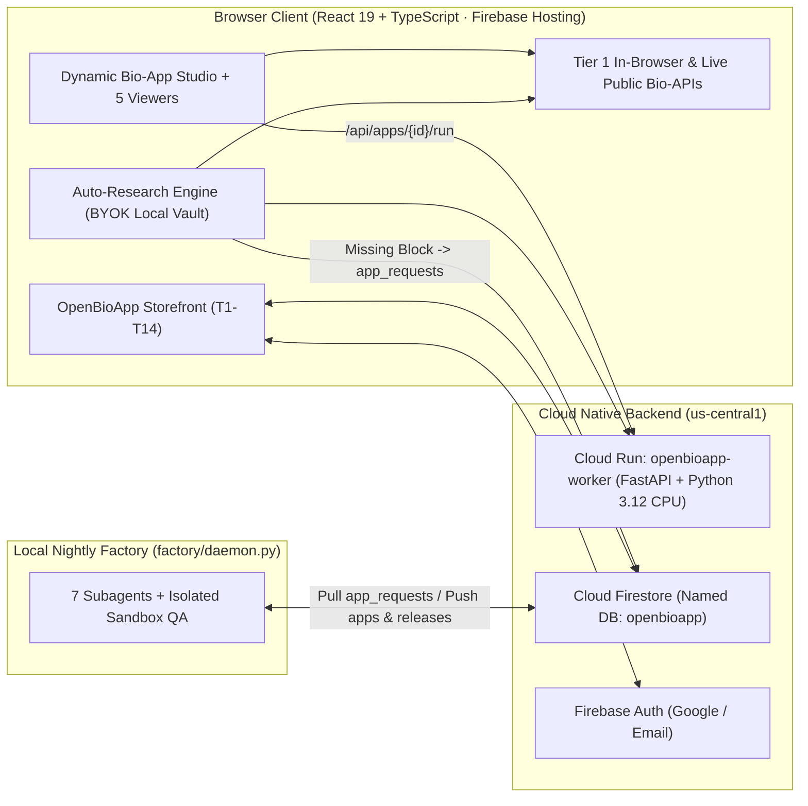

# OpenBioApp

> **The Self-Growing Biomedical Open-Source Web App Store & Block-Only Reproducible Auto-Research Suite**
>
> **Live Web App:** [https://openbioapp.web.app](https://openbioapp.web.app) · **License:** Apache-2.0

`OpenBioApp` turns complex biomedical open-source repositories, command-line tools, and public bio-APIs into **3-second, zero-install interactive web studios**—and composes those verified blocks into a **zero-hallucination, reproducible Auto-Research workflow**.

Wet-lab biologists, clinicians, and bioinformaticians no longer have to wrestle with broken Conda environments, C++ compilers, Excel-corrupted gene symbols (`1-Mar` → `MARCHF1`), or messy mass-spectrometer headers just to run a single paper's algorithm.

---

## Key Capabilities

1. **Zero-Install Scientific Studios (`T12` App Detail Studio)**
   - Every app ships with a **1-click golden sample (`Try Sample (3s)`)**, drag-and-drop input sanitizers, and **5 standardized biomedical viewers**:
     - `InteractiveDataTableViewer` (sortable/filterable scientific tables + 1-click CSV export)
     - `ScientificPlotViewer` (high-DPI interactive SVG spectrum + theoretical isotope envelope overlays with peak zoom, Volcano plots, Kaplan-Meier survival curves, enrichment bar charts, and 2D UMAP/SVD scatters)
     - `Molecule3DViewer` (60fps interactive 3D protein ribbon viewer colored by AlphaFold pLDDT confidence)
     - `SequenceAndTrackViewer` (annotated DNA/protein sequence tracks for PCR primers & CRISPR guides)
     - `Audited Markdown Report`
2. **Typed Bio-Artifact Chaining (`BioType` Graph)**
   - Outputs carry strict biomedical types (`GeneSet`, `TargetProfile`, `CompoundSet`, `ProteinStructure`, `MassSpectrumAssignment`, `VariantAnnotation`, `ExpressionMatrix`, `SurvivalCohort`, `SequenceDesign`).
   - Clicking **Chain Output to Compatible App** automatically passes downstream inputs into compatible apps without manual reformatting.
3. **Block-Only Reproducible Auto-Research (`T5` Suite · BYOK + Zero-Key Benchmarks)**
   - Unlike free-form LLM code-generation loops where hallucinated Python scripts silently fabricate p-values, `OpenBioApp` enforces a strict **Block-Only Invariant**:
     - **PI Planner** decomposes a biomedical hypothesis into a DAG of **registered, regression-tested `OpenBioApp` blocks**.
     - **Block Executor** runs real scientific engines and live public APIs with full parameter provenance.
     - **Independent Scientific Auditor** checks statistical significance, toxicity flags (PAINS/Brenk), and structural confidence (pLDDT).
     - **Self-Growing Loop**: Whenever a required capability is missing from the store, the engine automatically files a structured specification into the `app_requests` queue for the Nightly Factory.
   - API keys (`Gemini`, `OpenAI`, `Anthropic`) stay **100% inside browser `localStorage`** (`T14 Settings ⌘,`) and never touch our servers. Three live multi-step missions also run out-of-the-box with zero API key.
4. **Nightly 7-Subagent Repo-to-App Factory (`factory/`)**
   - Autonomous local pipeline (`ChiefEditor` → `ScoutLicenseAuditor` → `CoreExtractorPorter` → `BioUIArchitect` → `ScientificQAValidator` → `CatalogPublisher` → `FeedbackHealer`) that audits licenses, strips GPU/GUI dependencies, builds `bioapp.yaml` manifests, verifies golden outputs in an isolated sandbox, and publishes nightly release notes to Firestore (`T10 Updates`).

---

## Architecture



---

## Verified Starter Catalog (12 Domain Studios + 3 Bridge Utilities)

| App ID | Name | Tier | Scientific Engine / Upstream Source |
| :--- | :--- | :--- | :--- |
| `nucleospec-dna-agnc` | **NucleoSpec ESI-MS Studio** | Cloud Run CPU | Copp Lab `NucleoSpec` (`PythoMS` + `IsoSpecPy` C++ exact isotope envelope fitting for DNA-stabilized Ag nanoclusters + raw MS header sanitizer) |
| `opentargets-explorer` | **OpenTargets Evidence Atlas** | Public API | Live OpenTargets Platform v4 GraphQL (`MONDO`/`EFO` disease-to-target genetic & clinical evidence) |
| `alphafold-3d-studio` | **AlphaFold DB 3D Inspector** | Public API | Live UniProt Swiss-Prot + EBI AlphaFold DB v6 3D coordinate & per-residue pLDDT confidence inspector |
| `chembl-drug-finder` | **ChEMBL Clinical Drug Hunter** | Public API | Live EBI ChEMBL v34 mechanism-of-action & approved/clinical inhibitor discovery with canonical SMILES |
| `rdkit-mol-profiler` | **RDKit ADMET & PAINS Profiler** | Cloud Run CPU | `RDKit` exact QED, Wildman-Crippen cLogP, TPSA, Lipinski/Veber rules, and `FilterCatalog` PAINS & Brenk alerts |
| `deseq2-deg-studio` | **RNA-seq DEG & Volcano Studio** | Cloud Run CPU | DESeq2 median-of-ratios size-factor normalization, empirical-Bayes moderated test, BH-FDR, and Excel date-gene restorer |
| `enrichr-pathway-studio` | **Enrichr Pathway & GO Studio** | Public API + Relay | Live Ma'ayan Lab Enrichr Fisher exact test & combined score enrichment (`KEGG`, `Reactome`, `GO BP`) |
| `clinvar-variant-annotator` | **ClinVar & MyVariant Pathogenicity** | Public API | Live `MyVariant.info` (`ClinVar` clinical significance, `CADD` phred, `dbSNP`, `gnomAD`) |
| `lifelines-survival-studio` | **Lifelines Clinical Survival** | Cloud Run CPU | `lifelines` Kaplan-Meier estimator, Greenwood 95% CI, and exact two-group Log-Rank $\chi^2$ test |
| `celltypist-pbmc-profiler` | **Single-Cell Immune Marker Studio** | Cloud Run CPU | Log1p-CPM normalization, canonical PBMC immune lineage scoring, and 2D truncated SVD embedding |
| `primer3-pcr-designer` | **Primer3 Thermodynamic Designer** | Browser Local | SantaLucia (1998) nearest-neighbor $\Delta H^\circ / \Delta S^\circ / T_m$, GC clamp, and hairpin/3'-dimer screening |
| `crispr-guide-designer` | **CRISPR Cas9/Cas12a Guide Scorer** | Browser Local | `SpCas9` (`NGG`) & `AsCas12a` (`TTTV`) PAM scanning, position-weighted efficiency, and homopolymer filtering |
| `smart-table-filter` | **Smart Table Filter & Top-K Bridge** | Utility Bridge | Deterministic threshold/top-$K$ row filtering and typed column projection (`GeneSet`, `CompoundSet`) |
| `bio-id-harmonizer` | **Universal Bio-ID Harmonizer** | Utility Bridge | Live `MyGene.info` v3 batch symbol/Ensembl/Entrez/UniProt harmonization + Excel date-corruption rescue |
| `consensus-rank-aggregator` | **Multi-Evidence Consensus Ranker** | Utility Bridge | Weighted Borda & geometric rank aggregation across multi-omics evidence tables |

---

## Repository Structure

```text
OpenBioApp/
├── apps/                        # 15 declarative bioapp.yaml manifests (schema v1.0.0)
├── design-reference/            # CUA Mac App Store Brand Design System (T1-T14 tokens & spec)
├── factory/                     # Nightly 7-subagent Repo-to-App conversion pipeline & pytest suite
│   ├── agents.py                # ChiefEditor, Scout, Porter, Architect, QA, Publisher, Healer
│   ├── daemon.py                # CLI entrypoint + Firestore catalog/releases sync
│   └── llm_runners.py           # Pluggable Gemini CLI / Claude CLI / BYOK API runners
├── src/                         # React 19 + TypeScript + Vite frontend
│   ├── components/studio/       # BioAppExecutionStudio (3s sample, sanitizers, chaining)
│   ├── components/viewers/      # 5 standardized biomedical viewers (SVG plots, 3D PDB, tracks)
│   ├── lib/auto-research/       # Block-only PI -> Executor -> Auditor engine
│   ├── lib/runners/             # Tier 1 browser & live public API + Tier 2 Cloud Run dispatchers
│   ├── lib/schema/              # Typed BioAppManifest & BioType compatibility graph
│   ├── lib/workspace/           # Firebase Auth + Firestore (openbioapp) + local BYOK store
│   └── views/                   # Storefront (T1-T11), AppDetail (T12), Workspace, AutoResearch (T5)
├── worker/                      # Stateless FastAPI Python 3.12 scientific CPU worker
│   ├── app/engines/             # NucleoSpec, RDKit, DEG, Lifelines, Single-Cell engines
│   ├── app/sanitizers.py        # Raw MS spectrum header stripper & Excel gene symbol restorer
│   ├── vendor/nucleospec/       # Copp Lab NucleoSpec core + PythoMS (with NOTICE.md)
│   └── Dockerfile               # Linux container building IsoSpecPy C++ extension
├── docker-compose.yml           # One-command local self-hosting (web + worker)
├── firebase.json                # Firebase Hosting + /api/** Cloud Run rewrite + Firestore config
└── firestore.rules              # Least-privilege Firestore security rules for named DB 'openbioapp'
```

---

## Quickstart

### Option 1: One-Command Docker Self-Hosting

```bash
git clone https://github.com/prairie-meow/OpenBioApp.git
cd OpenBioApp
docker compose up --build
```

- Web Storefront & Studio: `http://localhost:5173`
- Scientific Worker API & Docs: `http://localhost:8080/docs`

### Option 2: Local Native Development (Frontend + Python Worker)

```bash
# 1. Start the Python Scientific Worker (port 8080)
cd worker
python3 -m venv .venv
source .venv/bin/activate
pip install -r requirements.txt
python -m pytest tests/test_worker.py
uvicorn app.main:app --reload --port 8080

# 2. Start the Vite Frontend (port 5173, proxies /api -> localhost:8080)
cd ..
npm install
npm run dev
```

### Running the Nightly 7-Subagent Factory

```bash
# Run offline dry-run audit & sandbox QA cycle
python3 -m factory.daemon --dry-run

# Regenerate all apps/*/bioapp.yaml manifests and sync to Firestore 'openbioapp'
python3 -m factory.daemon --write-manifests --seed-firestore
```

---

## Privacy, Security & Scientific Attribution

- **Zero Server-Side Raw Data Retention**: Uploaded spectra and expression tables sent to `openbioapp-worker` are processed strictly in ephemeral RAM and discarded immediately upon HTTP response completion.
- **Browser-Only BYOK Vault**: LLM API keys configured in `Settings (⌘,)` are stored exclusively in the user's browser `localStorage` and are never written to Firestore or backend logs.
- **Scientific Attribution**:
  - **NucleoSpec** (`worker/vendor/nucleospec/`) was created by **Copp Lab (UC Irvine)** ([copplab/NucleoSpec](https://github.com/copplab/NucleoSpec), DOI: [`10.1021/acsmeasuresciau.6c00178`](https://doi.org/10.1021/acsmeasuresciau.6c00178)) under **CC BY-NC 4.0**, incorporating **PythoMS** by Lars Yunker (MIT License). See [`worker/vendor/nucleospec/NOTICE.md`](worker/vendor/nucleospec/NOTICE.md).
  - Live public biomedical data is retrieved directly from **OpenTargets**, **EMBL-EBI AlphaFold DB & UniProt & ChEMBL**, **Ma'ayan Lab Enrichr**, and **BioThings (`MyVariant.info` / `MyGene.info`)**.
